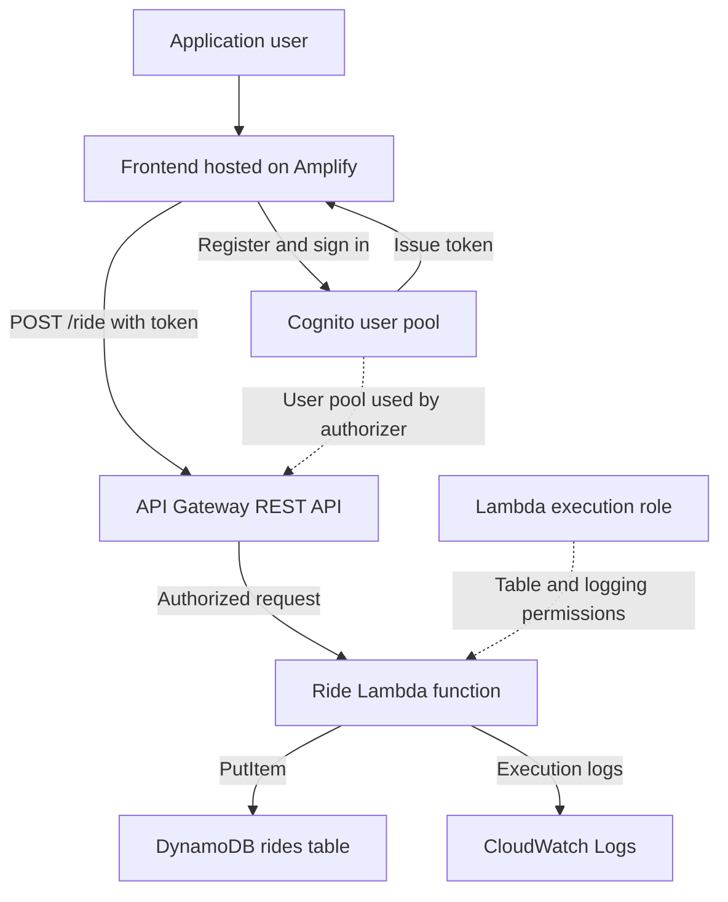
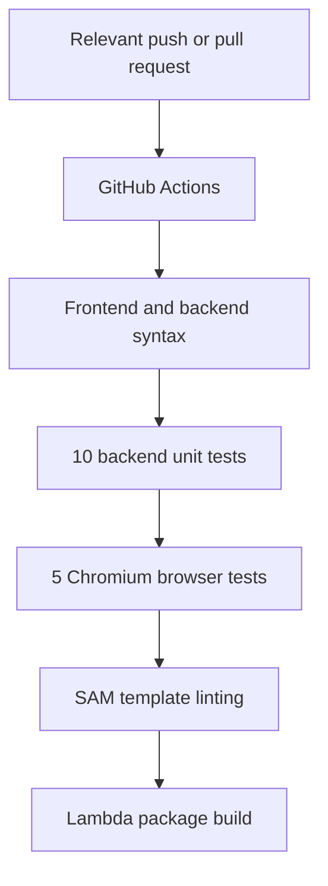

# Application Architecture

## Deployment Status

The current revision is not deployed to AWS.

This document describes the architecture defined by the source
code and AWS SAM template. Live integration and IAM enforcement
remain unverified.

## Application Request Flow

Amplify hosting is configured separately.
The backend resources are defined in infra/template.yaml.

The API authorizer validates the Cognito token.
Lambda then checks the expected username claim and validates
the request payload before attempting a database write.

## Two Different Access Controls

| Access control | Purpose |
|---|---|
| Cognito and the API Gateway authorizer | Authenticate application users and authorize API requests |
| Lambda execution role | Permit the function to write ride records and execution logs |

A user's Cognito token is not the Lambda function's AWS credentials.

The function uses its execution role for AWS service access.

## Backend Resources

| Resource | Configuration |
|---|---|
| Cognito user pool | Email-based registration and verification |
| Cognito app client | Browser client without a client secret |
| API Gateway | Regional REST API with a dev stage |
| Ride endpoint | POST /ride with a Cognito authorizer |
| CORS preflight | OPTIONS without Cognito authentication |
| Lambda | Node.js 22 with a 10-second timeout |
| DynamoDB | On-demand billing and RideId partition key |
| Execution role | Table-scoped writes and log-group-scoped logging |
| CloudWatch log group | Seven-day retention |

## Request Processing

1. API Gateway validates the supplied Cognito token.
2. Lambda checks for the expected username claim.
3. Lambda parses the JSON request body.
4. Lambda validates numeric latitude and longitude ranges.
5. Lambda checks that the table name is configured.
6. Lambda creates a ride ID and selects a simulated unicorn.
7. Lambda writes the ride record to DynamoDB.
8. Lambda returns a 201 response after a successful write.

The selected unicorn is simulated.
This application does not dispatch real transportation.

## Error Handling

| Condition | Handler response |
|---|---|
| Missing expected authentication claim | 401 |
| Missing or malformed JSON body | 400 |
| Missing or invalid coordinates | 400 |
| Missing table configuration | Generic 500 |
| Database operation failure | Generic 500 |

API Gateway can reject invalid or missing tokens before Lambda
runs. Those responses are distinct from handler-level checks.

## Frontend Behavior Without AWS

The committed js/config.js contains empty connection settings.

In this state:
- Registration, sign-in, and verification controls are disabled.
- Ride requests are disabled.
- The interface explains that no AWS deployment is connected.
- Authentication tokens are not displayed.
- Sign-out safely redirects to the sign-in page.

The page may still load the external map service.
The browser tests stub that service rather than verify it.

## Logging

The handler records:
- Event names.
- Request IDs.
- Ride IDs.
- Error types for failed processing.

It avoids logging full request events, authentication tokens,
passwords, and pickup coordinates.

## Automated Verification

This workflow validates and builds the project.
It does not deploy resources to AWS.

## Verification Boundaries

- Backend tests mock DynamoDB calls.
- Browser tests cover inactive configuration.
- External map functionality is stubbed during browser tests.
- IAM enforcement requires live AWS testing.
- Successful authentication and end-to-end requests require
  a deployed environment.

Historical deployment screenshots are retained in README.md.
They do not prove the current revision works in AWS.
